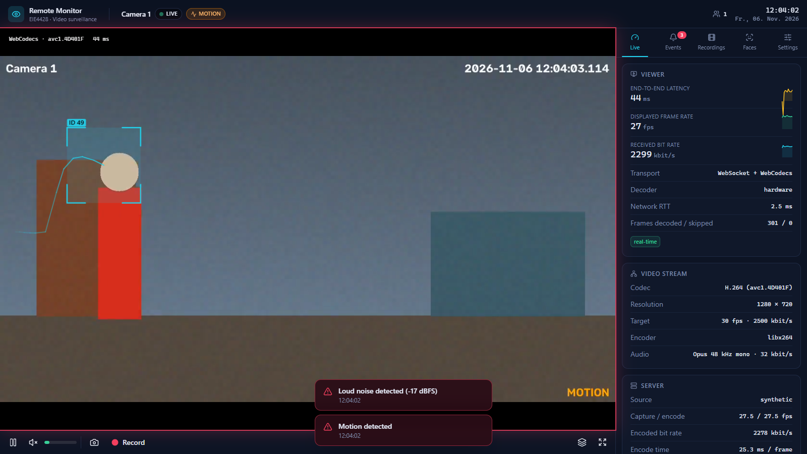

# Remote Monitor — Web-based Remote Video Monitoring

EIE4428 Multimedia Communications mini-project (PolyU, 2026/27).

A self-written remote video monitoring system: a Python video server captures the webcam,
compresses it to **H.264** (+ **Opus** audio) and streams it over **WebSocket** to any number of
browsers, which decode it with **WebCodecs** in real time (~40–120 ms latency on LAN).
Includes motion detection with alarms, object tracking, face detection/recognition, emotion
recognition, MP4 recording with pre-roll, event log, digital PTZ, login and HTTPS.
No WebRTC / media-server frameworks.



## Quick start (Windows)

```powershell
.\start.ps1                       # webcam 0 + microphone
.\start.ps1 --source synthetic    # demo without camera
.\start.ps1 --password eie4428    # require login (recommended for Internet access)
```

Open the printed URL — `http://localhost:8000` on the server, `https://<server-ip>:8443` on
other PCs (accept the self-signed certificate once). Linux/macOS: `./start.sh`.

Requirements: Python ≥ 3.12, Node.js ≥ 20, a webcam (optional).
All start options: **[docs/GETTING_STARTED.md](docs/GETTING_STARTED.md)**.

## Other clients

* Native reception software: `cd server; uv run remote-monitor viewer https://<server-ip>:8443 --audio`
* VLC / any player: `http://<server-ip>:8000/api/stream.mjpg`
* Standalone executable: `.\build-exe.ps1` → `server\dist\RemoteMonitor\RemoteMonitor.exe`

## Tests

```powershell
cd server; uv run pytest           # 17 unit + end-to-end tests
cd web;    npm test                # protocol / clock-sync tests
cd web;    node scripts/e2e.mjs    # headless-Chrome test against a running server
```

## Documentation

* [docs/GETTING_STARTED.md](docs/GETTING_STARTED.md) — **how to start the system, all options, troubleshooting**
* [docs/ARCHITECTURE.md](docs/ARCHITECTURE.md) — how the system works, design decisions, protocol, measurements
* [report/report.pdf](report/report.pdf) — project report (EIE4428 template)
* REST API: `http://localhost:8000/api/docs`
