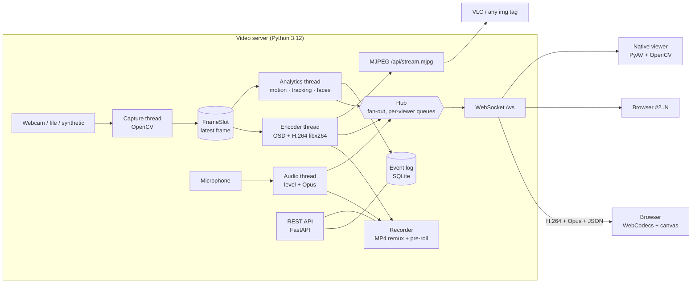

# Remote Monitor: Architecture and Design Decisions

This document explains how the remote video monitoring system works, why it is built the way it is, and where to find each part in the code. It is written for the group members and for anyone who has to maintain, demo or grade the system.

> **TL;DR.** A Python server captures the webcam, compresses every frame to **H.264** (and the microphone to **Opus**), and pushes the compressed packets over **one WebSocket per viewer**. The browser decodes them with the **WebCodecs** API (hardware-accelerated) and paints them on a `<canvas>`. Motion detection, object tracking, face detection/recognition and emotion recognition run in a separate thread on the server. Their results are sent as small JSON messages, which the browser draws as an overlay. No WebRTC, no media server: the capture, compression, transport and playback pipeline is our own code.

---

## 1. Requirements → design

| Requirement (project sheet) | How it is met |
|---|---|
| Video server captures and compresses every frame | `capture.py` (OpenCV) → `encoder.py` (FFmpeg/libx264 via PyAV) |
| Interface between video server and web | FastAPI/uvicorn: REST + WebSocket `/ws` + MJPEG `/api/stream.mjpg` (`app.py`) |
| Web page that links to the video server | React single-page app (`web/`), served by the same server |
| Standard browser **or** standalone reception software | Browser UI (Chrome/Edge/Firefox/Safari) **and** native viewer `remote-monitor viewer` |
| Real-time access from remote PCs | Low-latency pipeline (~40–120 ms glass-to-glass on LAN), HTTPS on the LAN, Internet via tunnel/port forwarding |
| Not built on WebRTC, Owncast, OSP or Red5 | Own protocol on top of WebSocket; FFmpeg is used only as a codec library |
| Advanced features (timing, motion, faces, recording, audio, tracking, emotion, concurrency) | All implemented, see §6 |

### Why not WebRTC (or a media server)?

The task forbids the listed tools, and we wanted to implement the multimedia pipeline ourselves (capture → compression → packetisation → transport → decoding → rendering). The 2020s browser platform makes this possible without plug-ins:

* **WebCodecs** (`VideoDecoder`, `AudioDecoder`) gives JavaScript direct access to the browser's hardware video decoder. Before WebCodecs, the only options were WebRTC, MSE (with its higher buffering latency) or MJPEG.
* **WebSocket** gives a reliable, ordered, full-duplex channel through every proxy and firewall that allows HTTPS. It carries both binary media and JSON control messages.

We evaluated these alternatives:

| Option | Verdict |
|---|---|
| WebRTC | Forbidden by the task; also hides the codec/transport details we are supposed to learn. |
| HLS / DASH (segments + MSE) | 2–6 s latency, which is too slow for live monitoring. |
| fMP4 over WebSocket into MSE | Works, but the MSE buffer adds latency and the muxing on both sides adds complexity. |
| **H.264 Annex-B over WebSocket into WebCodecs** | **Chosen**: frame-level control, lowest latency, hardware decode. |
| MJPEG over HTTP | Kept as a **fallback**: it works in any `` tag, in VLC and on HTTP-only origins, but needs ~5–10× the bandwidth of H.264. |
| WebTransport (HTTP/3, QUIC) | Promising (unreliable datagrams, no head-of-line blocking), but immature Python server support and it needs real certificates. Listed as future work. |

---

## 2. System overview



Everything runs in **one process** and is started with a single command. The process listens on HTTP `:8000` and on HTTPS `:8443` (self-signed certificate, generated automatically).

### Repository layout

```
server/                       Python package "remote_monitor" (uv project)
  src/remote_monitor/
    cli.py                    command line: serve | viewer | models
    config.py                 static config (env/CLI) + live RuntimeSettings (persisted JSON)
    capture.py                camera/file/synthetic sources, CaptureThread, FrameSlot
    encoder.py                H.264 encoder, Annex-B parsing, RFC 6381 codec string
    audio.py                  microphone capture, dBFS level, Opus encoder
    osd.py                    burned-in timestamp / camera name / REC / MOTION
    analytics/motion.py       MOG2 background subtraction + alarm state machine
    analytics/tracker.py      multi-object tracker (alpha-beta filter, IoU + distance)
    analytics/faces.py        YuNet detection, SFace recognition, FER emotion, gallery
    analytics/engine.py       analytics thread
    hub.py                    fan-out to viewers, congestion control
    protocol.py               binary media header
    recorder.py               MP4 recorder with pre-roll ring buffer
    events.py                 SQLite event log
    auth.py                   password + HMAC session tokens
    certs.py                  self-signed TLS certificate with LAN IPs
    service.py                MonitorService - wires everything together
    app.py                    FastAPI routes, WebSocket endpoint, static web app
    viewer.py                 native reception software
  tests/                      pytest unit + end-to-end tests
  remote-monitor.spec         PyInstaller build of RemoteMonitor.exe
web/                          React 19 + TypeScript + Vite + Tailwind CSS 4
  src/lib/                    protocol, clock sync, WebCodecs players, overlay, connection
  src/components/, panels/    UI
  scripts/e2e.mjs             automated browser test (headless Chrome)
docs/                         this document, screenshots
report/                       Typst source + PDF of the project report
```

---

## 3. Server pipeline in detail

### 3.1 Threads and the "latest frame" principle

Blocking, CPU-heavy work runs in threads. OpenCV and FFmpeg release the Python GIL inside their C code, so the threads really run in parallel. Network I/O runs on one asyncio event loop.

| Thread | Work | Rate |
|---|---|---|
| `capture` | `VideoCapture.read()`, resize, mirror/flip | camera rate (≤ configured fps) |
| `encoder` | copy frame, draw OSD, BGR→I420, H.264 encode, recorder, MJPEG | every captured frame |
| `analytics` | motion, tracking, faces (every 2nd run) | ≤ 15 Hz, adapts to CPU |
| `audio` | 20 ms PCM blocks → dBFS → Opus | 50 packets/s |
| asyncio loop | Hub, WebSockets, REST, stats every 1 s | event-driven |

The capture thread writes each frame into a `FrameSlot`, a mailbox that holds one element. Consumers always take the **newest** frame and skip older ones. When a consumer is slow (for example face recognition on a weak laptop), frames are **dropped instead of queued**. Latency therefore stays bounded, and a slow analytics stage can never lower the streamed frame rate. Threads hand results to the event loop only through `loop.call_soon_threadsafe`, so the Hub needs no locks.

### 3.2 Capture (`capture.py`)

* Windows uses the DirectShow backend, which opens in about 1 s. Media Foundation was not able to open the test laptop's camera. The capture requests the **MJPG** FourCC because USB-2 webcams can only deliver HD at full frame rate as MJPG; raw YUY2 is bandwidth-limited.
* Robustness: if the camera stops delivering frames (unplugged, or taken over by another app), the thread closes and reopens it with exponential back-off (0.5 s → 5 s). Changing the resolution or fps also triggers a reopen.
* `--source synthetic` renders an animated room with an "intruder" that walks through the scene for 6 s every 12 s. This makes tests deterministic and allows a demo without a camera. `--source file.mp4` loops a video file.

### 3.3 Compression (`encoder.py`)

| Decision | Reason |
|---|---|
| **H.264 Main profile**, libx264 | Every browser hardware-decodes H.264 through WebCodecs. Main profile (CABAC) compresses about 10–15 % better than Baseline. H.265/AV1 decoding is not universal yet. |
| `preset=veryfast`, `tune=zerolatency` | No B-frames, no look-ahead, no frame threading: **one frame in → one packet out**, with zero encoder delay. Measured ~9–15 ms per 720p frame. |
| Rate control: target bitrate + VBV cap (buffer = 0.5 s) | Bounds the bitrate spikes that would otherwise fill socket buffers and add latency. |
| GOP = 2 s, `scenecut=0` + **on-demand IDR** | A long GOP gives good compression. A new viewer, a recovering viewer or a recording start asks for an IDR frame (rate-limited to one per 0.3 s), so joining takes about 100 ms. |
| **Annex-B with in-band SPS/PPS** before every IDR | A decoder can start at any keyframe without out-of-band data. The server parses the SPS to build the exact RFC 6381 codec string (for example `avc1.4D401F`), which the browser needs for `VideoDecoder.configure()`. |
| BGR→I420 with `cv2.cvtColor` | SIMD-optimised and releases the GIL, so it is faster than swscale here. |
| Hardware encoders selectable | `--encoder h264_nvenc / h264_qsv / h264_amf / h264_mf` (NVIDIA/Intel/AMD/Windows MF), with automatic fallback to libx264. |

Audio uses **Opus**, 48 kHz mono, 32 kbit/s, `application=lowdelay`, 20 ms frames. It is the standard codec for interactive audio and is natively supported by WebCodecs' `AudioDecoder`.

### 3.4 Transport protocol (`protocol.py`, `hub.py`)

There is one WebSocket per viewer: `wss://host:8443/ws?audio=0|1`.

**Binary media messages** (12-byte header, big endian):

```
 0      1      2        4                         12
 +------+------+--------+-------------------------+---------------
 | type | flags| rsvd   | capture timestamp (u64) | payload
 +------+------+--------+-------------------------+---------------
 type 1 = video (one H.264 access unit), 2 = audio (one Opus packet)
 flags bit0 = keyframe; timestamp = wall-clock µs (UTC) at capture
```

**JSON messages** (`{"t": ...}`):

* Server → client: `hello`, `video_config`, `audio_config`, `meta` (detections, about 15 Hz), `stats` (1 Hz), `level` (VU meter, 10 Hz), `event`, `settings`, `recording`, `pong`.
* Client → server: `ping` (clock sync), `keyframe` (request IDR), `audio` (on/off).

**Encode once, send N times.** The Hub sends the same encoded bytes to every viewer, so CPU cost does not grow with the number of viewers. Only bandwidth grows (about 2.5 Mbit/s per 720p viewer at the default setting). The number of viewers is unlimited by default (`--max-viewers` can cap it).

**Per-viewer congestion control.** TCP never drops data, so a slow viewer would accumulate an ever-growing delay. Each viewer therefore has its own send queue and sender task:

1. If more than about 1 s of video is queued for a viewer, all queued video and metadata is discarded and the viewer is marked `need_key`.
2. Nothing more is sent to it until the next keyframe, and one is requested immediately. The decoder therefore never receives a P-frame whose reference is missing, so there is no corrupted picture, and the viewer is back to real time within one GOP.
3. Control messages (events, settings) are never dropped. Metadata is skipped while the queue is backed up. Clock-sync `pong`s jump to the front of the queue.

Other viewers are not affected.

### 3.5 Timing and latency measurement

All timestamps are wall-clock microseconds at capture time. The browser estimates the server-clock offset with an **NTP-style exchange**: it sends `c`, the server answers `s`, then `offset = s − (c + rtt/2)`. The client uses the sample with the smallest RTT out of the last 8. When a frame is painted, the **end-to-end latency** is `clientNow + offset − captureTimestamp`. The value is shown live in the UI and was measured in the automated test (§8).

### 3.6 Analytics (`analytics/`)

Analytics run in their own thread on the newest frame, independently of encoding.

* **Motion detection** (`motion.py`): MOG2 Gaussian-mixture background model on a 320-px grey image → morphological opening (noise) and dilation (join blobs) → contours → boxes, filtered by a minimum area. The *sensitivity* slider maps to the minimum area (2 % … 0.04 % of the image) and to the MOG2 variance threshold. An **alarm state machine with hysteresis** raises the alarm at once and clears it only after *hold time* without motion, so the alarm does not flicker. **Global illumination changes** (a light switched on, auto-exposure) make more than 60 % of the pixels foreground; such frames are treated as a scene change and the model is relearned, so they do not raise false alarms.
* **Object tracking** (`tracker.py`): motion boxes are merged (one person often produces several blobs) and then associated to tracks by greedy assignment on *distance − IoU*. Each track has an **alpha-beta filter** (constant-velocity prediction), so short misses do not break its identity. A track is confirmed after 3 hits and deleted after 8 misses. Each track keeps a trail of its centre positions, which the UI draws as a path.
* **Faces** (`faces.py`), using OpenCV DNN models from the OpenCV Model Zoo on the CPU:
  * **YuNet** (2023): CNN face detector with 5 landmarks, run on a 640-px image.
  * **SFace**: 128-D face embedding. The aligned crop (similarity transform from the 5 landmarks) is compared with the enrolled gallery by cosine similarity; a value of 0.363 or more counts as the same person (threshold from the SFace evaluation). In our check, an enrolled face that was flipped and rescaled was still recognised with similarity 0.86, and a different person scored 0.13.
  * **Facial expression recognition** (MobileFaceNet, 7 classes: angry, disgust, fearful, happy, neutral, sad, surprised), run on the same aligned crop, so alignment is computed once per face.
  * Enrollment: the user types a name in the UI; the largest face in the current frame is stored (embedding + thumbnail).
* Results are sent as `meta` messages with **normalised coordinates** (0..1). The browser draws them as a vector overlay, which stays sharp at any digital zoom, can be switched on and off per viewer, and keeps the video itself clean.

### 3.7 Events, alarms, recording

* **Events** (SQLite, `events.py`): motion start/end, face detected, person recognised, unknown person (optional alarm), loud noise (audio level above a threshold), recording started/saved, viewer connected, failed login. Alarm events save a JPEG snapshot with the detection boxes drawn in.
* **Recording** (`recorder.py`): the already-compressed H.264 and Opus packets are **remuxed** into MP4 (`+faststart`). This costs no extra encoding CPU and gives exactly the streamed quality. The burned-in OSD timestamp gives every recording its timing information. A **pre-roll ring buffer** keeps the last two GOPs, so a motion-triggered recording starts *before* the motion and always begins with an IDR frame. Motion-triggered recordings stop after a configurable post-roll. Files longer than 30 min are split. When a setting change re-opens the encoder (new SPS), the recording is split cleanly and resumes at the next IDR.

### 3.8 Security

* Optional password (`--password`). Login issues a stateless **HMAC-SHA256 token** (12 h lifetime) in an `HttpOnly`, `SameSite=Strict` cookie. The same cookie authenticates REST calls and the WebSocket handshake. Wrong passwords are delayed by 1 s and logged.
* **HTTPS** on `:8443` with an automatically generated ECDSA certificate whose SubjectAltName lists every LAN IP. This is required: browsers expose WebCodecs only in a *secure context* (HTTPS or `localhost`).
* Path traversal is prevented for recordings, snapshots and face thumbnails (resolved paths must stay inside their folder; this is tested).

---

## 4. Browser client (`web/`)

Stack: **React 19 + TypeScript 7 + Vite 8 + Tailwind CSS 4**, **zustand** for state and **lucide** icons. The build output (≈ 90 kB gzip) is served by the Python server.

```mermaid
sequenceDiagram
    participant B as Browser
    participant S as Server
    B->>S: GET / (SPA), GET /api/session
    B->>S: WebSocket /ws (cookie)
    S-->>B: hello (settings, features)
    S-->>B: video_config {codec: avc1.4D401F, 1280x720}
    S-->>B: [video|key] IDR (forced on join)
    Note over B: VideoDecoder.configure(); decode IDR; paint canvas
    loop every frame
        S-->>B: [video] P-frame (12-byte header + H.264)
        B->>B: decode -> drawImage(VideoFrame) -> latency = now+offset-ts
    end
    loop ~15 Hz
        S-->>B: meta {motion, tracks, faces}
        B->>B: draw overlay canvas
    end
    B->>S: ping {c} / S-->>B: pong {c, s}   (every 2 s)
```

* `lib/videoPlayer.ts` passes every access unit straight to a `VideoDecoder` with `optimizeForLatency: true` and prefers hardware decoding. There is **no jitter buffer**: for monitoring, a fresh picture matters more than perfectly smooth motion. Robustness measures:
  * decoding starts only at a keyframe;
  * an IDR that arrives while the decoder is still being configured is stashed and used, which saves one round trip;
  * after a decoder error, or when the browser *reclaims* the codec, the decoder is recreated;
  * when the decode queue backs up (slow device), the player skips to the next keyframe;
  * decoding pauses while the tab is hidden;
  * keyframe requests are throttled to one per second per viewer.
* `lib/audioPlayer.ts`: Opus `AudioDecoder` → `AudioBuffer`s scheduled back-to-back on an `AudioContext`, with a 60 ms jitter buffer. If the queue exceeds 300 ms, playback is re-anchored so audio stays in step with the video. Browsers require a click before audio can play, so audio starts with the speaker button.
* `lib/connection.ts`: WebSocket with exponential-back-off reconnect, routing of media and JSON messages, clock sync and client statistics.
* **Fallback**: without WebCodecs (old browser, or a plain-HTTP LAN address) the UI automatically uses the MJPEG stream. The user can also force this mode in Settings.

### User interface

* **Video stage**:
  * live canvas with the analytics overlay;
  * digital **PTZ**: zoom up to 6× with the mouse wheel or buttons, pan by dragging or with the arrow pad;
  * fullscreen by double-click;
  * red pulsing frame during alarms;
  * status chips showing the codec and the live latency.
* **Control bar**: pause, listen/mute with volume and a live VU meter, snapshot (PNG including overlays), record button with running time, overlay toggles, fullscreen.
* **Side panel** (tabs):
  * **Live**: latency, fps and bitrate sparklines; transport, decoder and RTT; stream and server statistics.
  * **Events**: filterable timeline with snapshots.
  * **Recordings**: thumbnails, in-browser playback, download, delete.
  * **Faces**: enroll and delete known people.
  * **Settings**: resolution, fps, bitrate, GOP, mirror/flip, OSD, motion sensitivity, auto-record, face features, sound alarm, plus per-viewer preferences (alarm sound, desktop notifications, MJPEG mode).
* **Alarms**: toast message, beep (Web Audio) and an optional desktop notification when the tab is in the background.
* Responsive: below 1024 px width the side panel moves under the video. Dark "security console" theme.

---

## 5. Native reception software

`remote-monitor viewer https://<server>:8443 [--password ..] [--audio]` speaks the same WebSocket protocol. H.264 and Opus are decoded with FFmpeg (PyAV), audio is played through PortAudio, and video is shown in an OpenCV window with the detection overlay, fps and latency. Keys: `q` quit, `s` snapshot, `o` overlay, `f` fullscreen. Any player can also open `http://<server>:8000/api/stream.mjpg` (for example VLC).

---

## 6. Feature list

| Feature | Where |
|---|---|
| Live video, H.264, 640×360 … 1920×1080, 5–60 fps, 0.2–12 Mbit/s (configurable live) | encoder, settings |
| Live audio (Opus) + VU meter + loud-noise alarm | audio.py, audioPlayer.ts |
| Timing information (OSD timestamp in ms, in stream and recordings) | osd.py |
| Motion detection with alarm, sensitivity, hold time, illumination robustness | motion.py |
| Object tracking with IDs and trajectories | tracker.py, overlay.ts |
| Face detection, face recognition (enrollment), emotion recognition | faces.py |
| Recording (manual / motion-triggered, pre/post-roll, playback, download) | recorder.py, RecordingsPanel |
| Snapshots (server JPEG, client PNG with overlay, event snapshots) | service.py, VideoStage |
| Event log with snapshots, filters, notifications | events.py, EventsPanel |
| Unlimited concurrent viewers, per-viewer congestion control | hub.py |
| Digital PTZ (zoom/pan), fullscreen, overlay toggles | VideoStage.tsx |
| Password login, HTTPS, MJPEG fallback, native viewer | auth.py, certs.py, viewer.py |
| End-to-end latency / fps / bitrate measurement in the UI | clock.ts, LivePanel |

---

## 7. Running the system

```powershell
# Windows - everything in one step (installs deps, downloads models, builds UI, starts server)
.\start.ps1                         # webcam 0, microphone
.\start.ps1 --source synthetic      # no camera needed
.\start.ps1 --password eie4428      # require login

# manual
cd web;    npm ci; npm run build
cd server; uv sync; uv run remote-monitor models; uv run remote-monitor serve --source 0
```

The console prints all URLs, for example `https://192.168.1.23:8443`. On another PC, open the **https** address and accept the self-signed certificate once.

| Scenario | How |
|---|---|
| Same PC | `http://localhost:8000` (localhost counts as a secure context) |
| LAN | `https://<server-ip>:8443` |
| Internet, option A | Router port-forward of TCP 8443 to the server, then open `https://<public-ip>:8443` (use `--password`!) |
| Internet, option B (no router access) | `cloudflared tunnel --url http://localhost:8000` gives a public `https://….trycloudflare.com` URL with a valid certificate; WebSockets are supported |
| VLC / other player | `http://<server>:8000/api/stream.mjpg` |
| Native viewer | `uv run remote-monitor viewer https://<server-ip>:8443 --audio` |
| Standalone .exe | `build-exe.ps1` → `server\dist\RemoteMonitor\RemoteMonitor.exe` (no Python needed) |

Useful options: `--encoder h264_nvenc`, `--no-audio`, `--audio-device 2`, `--port`, `--https-port`, `--no-https`, `--max-viewers` (env `RM_MAX_VIEWERS`). Every option is also available as an environment variable `RM_<NAME>` or in `server/.env`. The REST API is documented interactively at `/api/docs` (OpenAPI).

---

## 8. Testing and measured performance

| Test | Command | Covers |
|---|---|---|
| Server unit + E2E (17 tests) | `cd server; uv run pytest` | protocol, encoder (keyframes, SPS, decodability), Opus, motion, tracker, auth, settings validation, hub congestion, MP4 recording with audio + pre-roll, full WebSocket stream, MJPEG, HTTP range requests, path traversal, login |
| Web unit tests | `cd web; npm test` | binary header compatibility with Python, clock sync, overlay maths |
| Browser E2E | `cd web; node scripts/e2e.mjs` (server running) | real headless Chrome: secure context, WebCodecs decoding, fps, latency, overlay, audio, recording, 3 concurrent viewers in separate browsers, MJPEG fallback, screenshots |

Measured on the development laptop (12 threads, synthetic 1280×720 source, all analytics enabled, libx264):

| Metric | Value |
|---|---|
| Capture / encode frame rate | 28.6–30 fps at 1280×720 (webcam: 15 fps, limited by the camera in low light) |
| Encode time | 9–19 ms per 720p frame (libx264 veryfast/zerolatency) |
| Analytics | ~13–15 Hz, ~37 ms per run (motion + tracking + YuNet + SFace + FER) |
| Bitrate | ≈ 2.3–2.5 Mbit/s at the 2500 kbit/s setting (720p30) |
| Displayed frame rate in Chrome | 30 fps, 0 frames skipped |
| End-to-end latency (capture → canvas) | **≈ 40–120 ms** on localhost / LAN |
| Time to first frame (incl. page load) | ≈ 1.3 s |
| Concurrent viewers tested | 3 browsers + MJPEG; the server encodes once, so the limit is bandwidth |

---

## 9. Known limitations and future work

* TCP head-of-line blocking on lossy links is handled by drop-to-keyframe; **WebTransport** datagrams or a NACK/FEC scheme would degrade more gracefully on Wi-Fi or mobile links.
* **Adaptive bitrate per viewer** (simulcast: a second, lower-resolution encoding for weak links).
* Multi-camera support (one `MonitorService` per camera).
* Two-way audio (talk-back) via `getUserMedia` + `AudioEncoder`.
* Person detection with a DNN (for example YOLO-NAS) instead of pure motion blobs, which would reduce false alarms from moving trees or curtains.
* Recordings are not encrypted at rest; there is a single shared password rather than individual user accounts.
